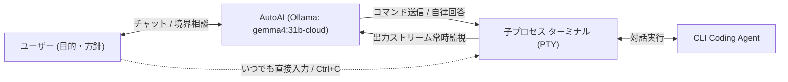
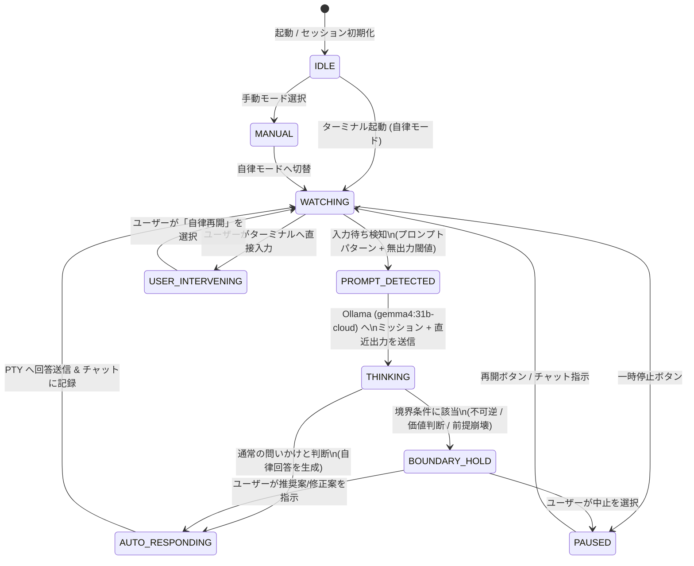

# AutoAIConsole UX 設計書

## 1. プロダクトの核心と三者構造

**AutoAIConsole** は、子プロセス（PTY）で動作する CLI 型 Coding Agent（Claude Code / Gemini CLI / Codex CLI / opencode / Aider 等）を、**Ollama 上の AI（既定モデル: `gemma4:31b-cloud`）** がユーザーに代わって操作・監視し、問いかけに自律的に回答することで目的を達成するデスクトップ GUI アプリである。



### 解決する課題
- **張り付き問題の解消**: CLI Coding Agent は確認（`Y/n`）、設計分岐、次手順の指示、エラー修正ループで頻繁に入力待ちになる。人間が張り付いて返答し続ける負担を AutoAI が引き受ける。
- **ブラックボックス不安の解消**: 「今 Agent が作業中なのか、入力待ちで止まっているのか」「AutoAI が何を根拠に何を入力したのか」をリアルタイムで見える化する。
- **介入の滑らかさ**: 自律運転中でも、ユーザーがターミナルへ直接キーボード入力や `Ctrl+C` を打てば即座に操作権を譲り、シームレスに協調できる。

---

## 2. UX 5 原則

1. **自律ファースト（承認ゲートを積まない）**
   - 既定モードは **自律運転（AUTONOMOUS）**。通常の確認・軽微な設計判断・テスト実行・エラー修正の継続は、共有したミッションに沿って AutoAI が即座に回答を送信して前へ進める。
   - ユーザーへ確認を求めるのは、**境界（不可逆・破壊的操作、外部送信、目的の前提崩壊、ユーザー固有の価値判断）** を検知したときだけ。境界では AutoAI が自律的に一時停止し、理由と推奨案を添えてチャットで相談する。
2. **ライブフィードバック（10 秒以上黙らない UI）**
   - ヘッダおよび監視バーに **現在の状態・最終監視からの経過秒（1 秒刻み）・自動応答回数・稼働時間** を常時表示する。
   - Coding Agent が処理中か入力待ちか、AutoAI が思考中かを色とアニメーションで即座に判別できる。
3. **思考と操作の双方向リンク**
   - AutoAI がターミナルへ自動送信したコマンドや回答は、チャットタイムラインに **「自律操作カード」** として記録される（検知した問いかけ原文・判断根拠・送信内容）。
   - ターミナル本体にも AutoAI 送信行を視覚的に区別表示（シアン系バッジ＋左アクセントライン）し、人間入力・Agent 出力・AutoAI 入力を一目で識別できる。
4. **いつでも手を出せる協調ターミナル**
   - 右ペインのターミナルは読み取り専用ログではなく、ユーザー自身が直接入力・`Ctrl+C`・コマンド送信を行える対話ターミナル。
   - ユーザーが直接入力すると AutoAI は衝突回避のため一時待機（`USER_INPUT`）へ移り、操作が落ち着いたら 1 クリックまたはチャット指示で自律監視へ戻せる。
5. **ミッション（判断基準）の常時可視化**
   - AutoAI が自律回答する際の拠り所となる **「目的（Goal）」「方針・制約」「停止境界」** をチャット上部のミッションバーにピン留めし、いつでも閲覧・編集できる。

---

## 3. 画面構成（レイアウト設計）

デスクトップ横長画面（推奨 `1280×800` 以上、最小 `1024×680`）を前提とした **2 ペイン分割構成（ドラッグで幅変更可、既定 42% : 58%）**。

```
+---------------------------------------------------------------------------------------------------+
| [AutoAIConsole] [セッション切替]   ● AUTONOMOUS 監視中 (更新: 1秒前 | 自動応答: 3)   [Model] [Mode] [⚙] |
+-------------------------------------------+-------------------------------------------------------+
|  [左ペイン: AI チャット & ミッション]     |  [右ペイン: ライブターミナル & 監視インスペクタ]       |
|                                           |                                                       |
|  ┌─ 現在のミッション (展開/折畳) ───────┐ |  [Agent: Claude Code ▼] [📁 S:\work\...] [起動][Ctrl+C] |
|  │ Goal: ○○機能の実装とテスト通過       │ |  ───────────────────────────────────────────────────  |
|  │ 方針: 正常系優先・確認は自律回答      │ |  $ claude                                           |
|  │ 境界: force push / 大量削除は相談     │ |  > Reading project files...                           |
|  └──────────────────────────────────────┘ |  ? Allow edit to src/app.py? (Y/n)                    |
|                                           |  [AutoAI→] y                                          |
|  [チャットタイムライン]                   |  ✓ Updated src/app.py                                 |
|   👤 ユーザー指示バブル                   |  > Running pytest...                                  |
|   🤖 AutoAI 応答・計画バブル              |  ▌                                                    |
|   ⚡ 自律操作カード (問いかけ/根拠/送信)   |                                                       |
|   ⚠ 境界相談カード (推奨案 / 修正 / 中止) |  ───────────────────────────────────────────────────  |
|                                           |  [監視ライブバー] 状態: 出力監視中 | 無出力: 0.8s      |
|  [クイック指示チップ]                     |  直近検知: "Allow edit to src/app.py? (Y/n)" (96%)     |
|  [メッセージ入力欄]               [送信]  |  [直接コマンド入力 > _______________________] [送信]   |
+-------------------------------------------+-------------------------------------------------------+
```

### 各領域の役割とインタラクション

| 領域 | 主な要素 | 役割・操作 |
|---|---|---|
| **トップバー** | アプリ名 / セッション名 / 状態ピル / 最終更新秒 / モデルセレクタ (`gemma4:31b-cloud`) / モード切替 (`自律`・`一時停止`・`手動`) / 設定ボタン | アプリ全体の稼働状態と Ollama モデルを常時把握・即切替。 |
| **ミッションバー（左上）** | Goal / 判断方針 / 停止境界 / 編集ボタン | AutoAI の自律判断基準を可視化・即時編集。 |
| **チャットタイムライン（左中）** | ユーザー発言 / AutoAI 発言 / ⚡自律操作カード / ⚠境界相談カード | 目的の伝達、進捗報告、自動回答の透明化、境界時の意思決定。 |
| **チャット入力欄（左下）** | クイック指示チップ / テキストエリア / 送信ボタン | 方針の追加・修正、質問、一時停止後の再開指示。 |
| **ターミナルツールバー（右上）** | Agent プリセット (`Claude Code`, `Gemini CLI`, `Codex CLI`, `opencode`, `PowerShell`) / 作業フォルダ / 起動・停止 / `Ctrl+C` / クリア / 入力主体バッジ | 子プロセス PTY のライフサイクル制御とプリセット起動。 |
| **ターミナル本体（右中）** | ANSI カラー出力表示 / AutoAI 送信行ハイライト / ユーザー直接キー入力 | Coding Agent の生出力をリアルタイム表示。フォーカスして直接キー入力も可能。 |
| **監視ライブバー（右下）** | ハートビート / 検知状態（出力中・プロンプト待ち・思考中・境界停止） / 信頼度ゲージ / 無出力秒数 / 直接 1 行送信欄 | 監視エンジンが「今どう判断しているか」を生データで見せる。 |
| **設定モーダル** | Ollama Base URL / モデル選択（既定 `gemma4:31b-cloud`）/ プロンプト検知アイドル秒数 / 境界停止ルール一覧 | モデルの切り替えや監視チューニング。 |

---

## 4. 状態遷移設計（自律監視エンジン）



---

## 5. 主要 UX シナリオ（GUI モックで体験可能）

### シナリオ A: 自律完走ループ（基本フロー）
1. ユーザーがチャットで「ログイン API のバリデーションを追加して、テストを通しておいて」と指示。
2. AutoAI がミッションバーを更新し、ターミナルで Coding Agent を起動・タスクを投入。
3. Coding Agent が `? Apply changes to src/auth.py? (Y/n)` や `? Run pytest now? (Y/n)` と問いかける。
4. 監視バーが `プロンプト検知` → `THINKING (gemma4:31b-cloud)` に遷移し、即座に `y` を自動送信。チャットに ⚡自律操作カードが追加され、判断理由が見える。
5. テスト全通過を検知すると、AutoAI が完了要約をチャットに報告する。

### シナリオ B: 境界検知による自律停止と相談
1. 作業中、Coding Agent が `git push --force origin main` や既存テーブル削除マイグレーションの実行可否を問いかける。
2. AutoAI が「不可逆・破壊的操作の境界」と判定し、回答を送信せず `BOUNDARY 境界相談中` 状態へ移行。
3. チャット欄に **⚠ 境界相談カード** を表示（リスク内容・推奨案「ローカル commit に留めて force push は拒否する」・選択肢ボタン）。
4. ユーザーが 1 クリックで「推奨案で回答 (`n` + 代替指示)」を選ぶと、AutoAI がそれをターミナルへ送り自律運転を再開する。

### シナリオ C: ユーザー直接介入（割り込み協調）
1. 自律監視中にユーザーがターミナル画面へ直接コマンドまたは `Ctrl+C` を入力。
2. 入力主体バッジが `ユーザー操作中（AutoAI待機）` に切り替わり、AutoAI は勝手に入力を被せない。
3. ユーザーの確認が終わったら「自律監視を再開」を押す（またはチャットで「続けて」と送る）だけでシームレスに復帰する。

---

## 6. 段階的実装ロードマップ（UI ファースト準拠）

| フェーズ | 内容 | 状態 |
|---|---|---|
| **Phase 1: UX 設計 & GUI モック（今回）** | UX 設計書 + 動作するデスクトップ GUI 骨格（FastAPI + pywebview + 全 UI 要素 + UX シナリオ体験シミュレータ）。実 PTY / 実 Ollama 未接続エンドポイントは「未実装」と明示応答。 | **今回完了** |
| **Phase 2: 実 PTY + xterm.js 正常系** | `pywinpty` で Windows ConPTY 子プロセスを起動し、WebSocket で `xterm.js` と双方向接続。 | 次フェーズ |
| **Phase 3: Ollama (`gemma4:31b-cloud`) 連携 & 自律監視正常系** | 出力ストリームの入力待ち検知 + Ollama 呼び出しによるチャット応答・自律回答送信・境界判定。 | 次フェーズ |
| **Phase 4: 準正常系・異常系・永続化** | セッション保存、プロセス異常終了復旧、Ollama タイムアウト制御、長大ログのウィンドウ圧縮。 | 以降 |
